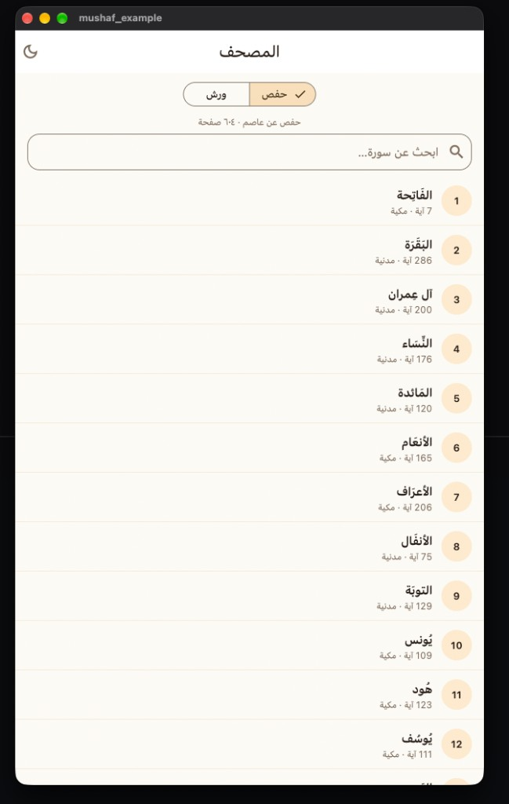
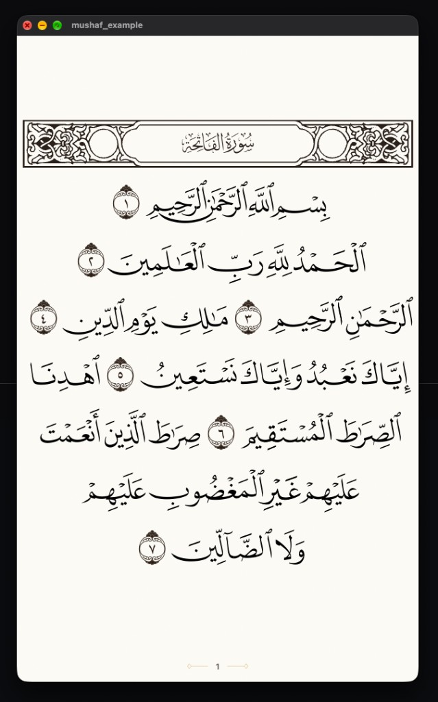
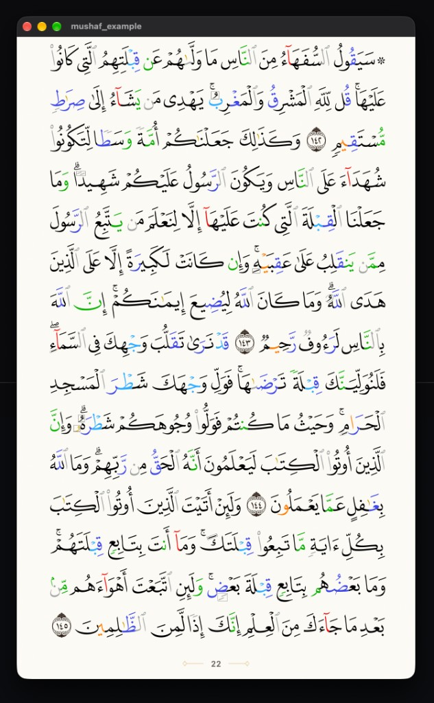
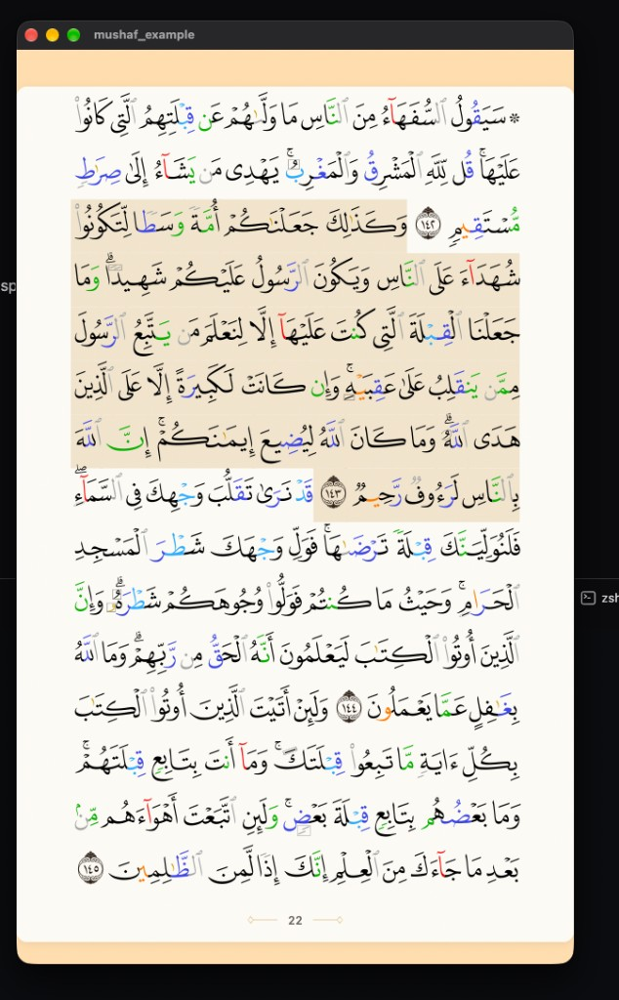
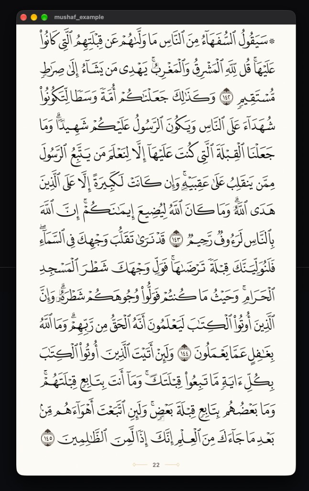
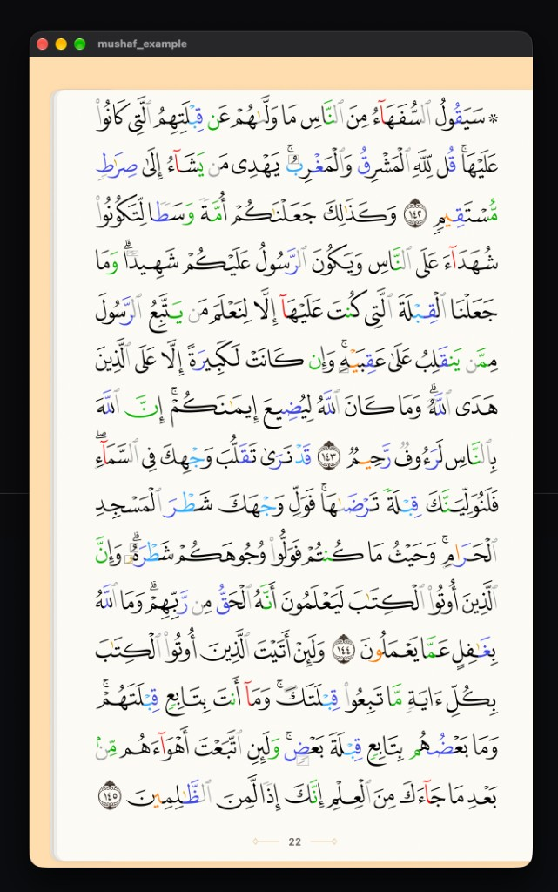
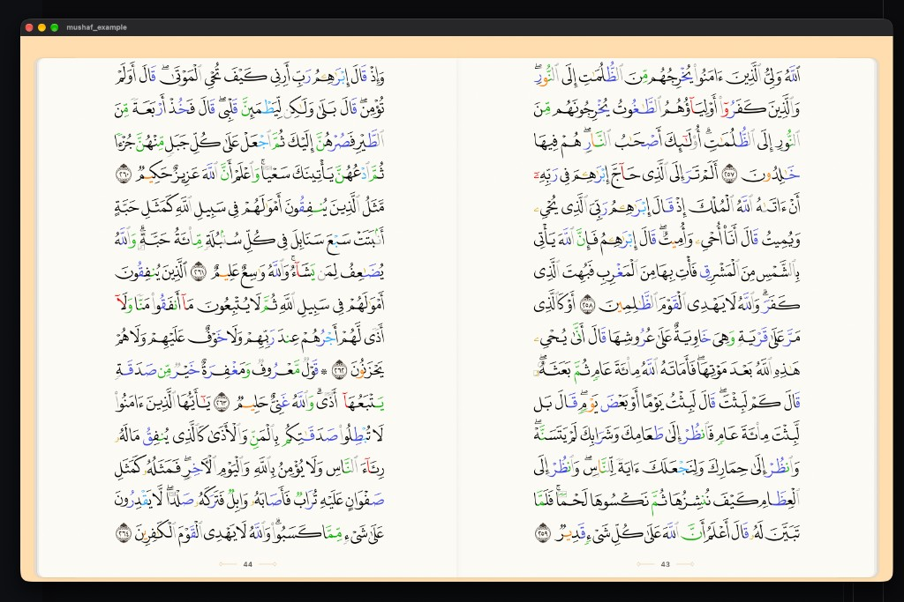

# mushaf

قارئ مصحف جاهز لـ Flutter، بروايتي **حفص عن عاصم** و**ورش عن نافع** في حزمة واحدة.

تفتح سورة، تقلب الصفحات، وتضغط ضغطاً مطوّلاً على الآية لتحديدها. من الإعدادات تختار ملء الشاشة أو شكل الكتاب، والتمرير الأفقي أو العمودي، وصفحة واحدة أو صفحتين عندما تكون النافذة عريضة وأفقية. حفص يُرسم بخطوط QCF4، ويمكن تلوين التجويد. ورش يُرسم بخط واحد مع ضبط السطور.

A Flutter mushaf reader for **Hafs (QCF4)** and **Warsh**: surah list, page turns, long-press ayah selection, fullscreen or book frame, and a two-page spread on a wide landscape window.

## المعاينة

من مثال الحزمة على macOS.

| قائمة السور | ورش — الفاتحة |
| --- | --- |
|  |  |

| حفص بالتجويد | تحديد الآية |
| --- | --- |
|  |  |

| ملء الشاشة | إطار الكتاب |
| --- | --- |
|  |  |

صفحتان متقابلتان في الوضع الأفقي العريض:



## ماذا ترى في القارئ

- قائمة السور مع البحث، والتبديل بين حفص (604 صفحة) وورش (599 صفحة).
- تحديد الآية بالضغط المطوّل، مع تمييزها، والانتقال إلى صفحة أو آية.
- ملء الشاشة، أو إطار كتاب بحواف الصفحات.
- تمرير أفقي أو عمودي.
- في النافذة العريضة الأفقية: صفحة واحدة أو صفحتان.
- شريط مصغّرات للصفحات، أو منزلق يقفز عند الإفلات.
- ساعة اختيارية، وخلفية سوداء في الوضع الليلي.
- تلوين التجويد لحفص فقط.

## التثبيت

```yaml
dependencies:
  mushaf: ^0.1.1
```

```dart
import 'package:flutter/material.dart';
import 'package:mushaf/mushaf.dart';

Future<void> main() async {
  WidgetsFlutterBinding.ensureInitialized();
  registerMushafHafsQcf4(localRoot: hafsPackRoot);
  registerMushafWarsh(localRoot: warshPackRoot);
  await Mushaf.initialize();
  runApp(const MyApp());
}
```

```dart
MushafReader(
  riwayah: MushafRiwayah.hafs,
  initialPage: 1,
  settings: const MushafReadingSettings(),
  onSettingsChanged: (settings) {},
  onAyahLongPress: (ref) {},
)
```

`MushafReaderController.goToPage` و`goToAyah` ينقلان الصفحة ويميزان الآية. لورش استخدم `MushafRiwayah.warsh` بعد `registerMushafWarsh`.

## من أين تأتي الصفحات؟

الحزمة هي برنامج الرسم والقراءة. نص الآيات وخطوط الصفحات يوفّرها تطبيقك، لأن ملفات حفص وحدها أكبر من حد النشر على pub.dev، وحقوقها مستقلة عن رخصة الكود.

بعد فك ضغط الحزمة على الجهاز:

- حفص: مجلد يحتوي `assets/quran/hafs_qcf4/` (خط لكل صفحة، وملفات التخطيط).
- ورش: مجلد يحتوي `assets/quran/warsh/` وخطوط ورش.

```bash
cd example
flutter run \
  --dart-define=MUSHAF_HAFS_ROOT=/path/to/extracted/hafs \
  --dart-define=MUSHAF_WARSH_ROOT=/path/to/extracted/warsh
```

بدون هذين المسارين يفتح المثال ويشرح أن النسخة غير مسجّلة.

## الترخيص

كود Dart تحت رخصة MIT. الخطوط ونص القرآن لهما شروط أصحاب الحقوق. راجع [LICENSE](LICENSE) و[NOTICE.md](NOTICE.md).
